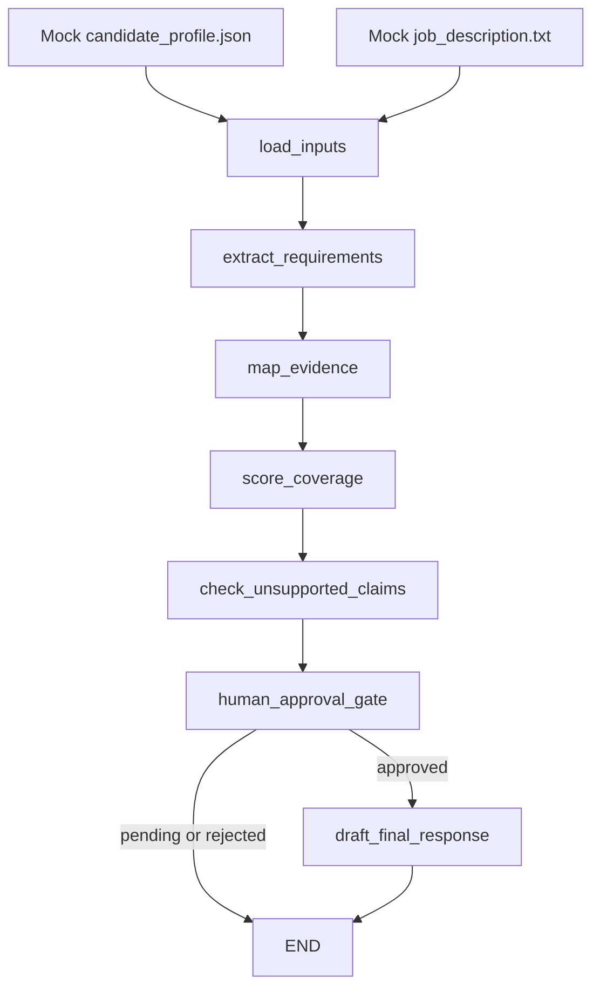

# LangGraph Review Workflow

Public-safe AI workflow that reviews a synthetic candidate profile against a
synthetic job description. The project demonstrates a LangGraph `StateGraph`,
LangChain Core runnable steps, structured Pydantic outputs, rubric scoring,
groundedness checks, and a human approval gate before safe final drafting.

No API key is required for the default demo. The workflow is deterministic so it
can be reviewed, tested, and run locally without sending data to a model.

## Why This Exists

This is a portfolio-proof project for AI workflow engineering. It shows how an
LLM-oriented review pipeline can be designed around evidence instead of
unsupported generation.

The workflow does not polish unsupported claims. It flags, blocks, and excludes
them from the final draft.

## Quick Start

```powershell
python -m pip install -e ".[dev]"
review-workflow demo
review-workflow demo --approve-final
pytest
```

Use the detailed view when you want the full per-requirement tables:

```powershell
review-workflow demo --approve-final --details
```

## Example Result

The approved demo run produces these key signals:

```text
Extracted 17 structured requirements.
Mapped evidence: 13 supported, 1 partial, 2 unsupported.
Weighted coverage: 31.0/34.0 (91.2%).
Groundedness: 3 grounded, 3 unsupported, 1 contradicted.
Approval: safe-only drafting approved.
Final draft: includes 3 grounded claims and excludes 4 blocked claims.
```

Blocked claims include synthetic examples such as production LangGraph
deployment experience, team leadership, expert German fluency, and cloud
architect certification.

## Architecture



## Workflow Steps

1. `load_inputs`
   Loads only synthetic mock files.

2. `extract_requirements`
   Parses the mock job description into structured requirements with stable IDs,
   categories, priorities, source sections, and keywords.

3. `map_evidence`
   Maps each requirement to explicit candidate evidence IDs. Requirements can be
   `supported`, `partially_supported`, `not_supported`, or `policy_constraint`.

4. `score_coverage`
   Applies a deterministic rubric:

   - `must_have`: 3 points
   - `should_have`: 2 points
   - `nice_to_have`: 1 point
   - `policy`: excluded from candidate fit score

5. `check_unsupported_claims`
   Reviews candidate-facing claims and marks them as `grounded`,
   `partially_grounded`, `unsupported`, or `contradicted`.

6. `human_approval_gate`
   Requires explicit approval before final drafting. Approval only allows
   grounded claims through.

7. `draft_final_response`
   Generates an evidence-cited final draft from approved grounded claims only.

## LiteLLM-Compatible Design

The default implementation is deterministic, but the boundaries are designed for
model-backed structured outputs:

- Workflow orchestration is isolated in `graph.py` and `nodes.py`.
- Each major step is a LangChain Core `RunnableLambda`.
- Structured contracts live in `schemas.py`.
- `model_boundary.py` documents the OpenAI-compatible LiteLLM swap point.

A production version could replace deterministic runnables with model-backed
structured-output calls while preserving the same graph state and Pydantic
schemas.

## Project Structure

```text
data/mock/
  candidate_profile.json
  job_description.txt
src/langgraph_review_workflow/
  cli.py
  graph.py
  model_boundary.py
  nodes.py
  schemas.py
  state.py
  steps/
    approval.py
    drafting.py
    evidence.py
    groundedness.py
    requirements.py
    scoring.py
tests/
  conftest.py
  test_approval_and_graph.py
  test_groundedness.py
  test_scoring.py
```

## Public-Safety Policy

This repository must use synthetic data only.

Do not add real CVs, real job applications, private job-search memory, email
content, phone numbers, addresses, or submitted application material.

The mock candidate profile and mock job description are fictional. They exist
only to demonstrate workflow behavior.

## Test Suite

```powershell
pytest
```

Current tests cover:

- weighted coverage scoring
- unsupported and contradicted claim detection
- approval-gated graph routing
- final draft exclusion of blocked claims

## Interview Talking Points

- The graph makes review state explicit and inspectable.
- The scoring rubric is deterministic and easy to test.
- Groundedness checks prevent unsupported claims from being rewritten as polish.
- Human approval controls the transition from analysis to final drafting.
- The default local path is API-free, while the model boundary remains
  LiteLLM-compatible for future structured-output model calls.
