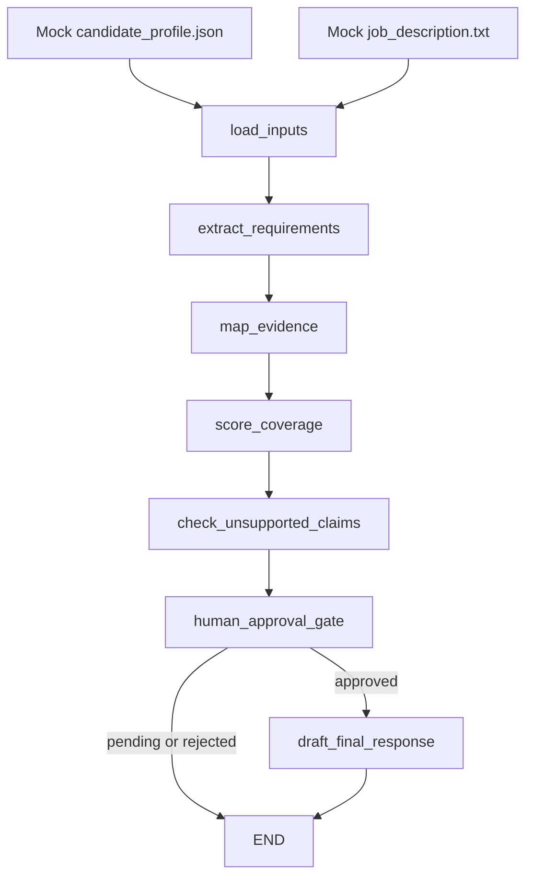

# LangGraph Review Workflow

Public-safe AI workflow that reviews a synthetic candidate profile against a
synthetic job description. The project demonstrates a LangGraph `StateGraph`,
LangChain Core runnable steps, structured Pydantic outputs, rubric scoring,
groundedness checks, and a human approval gate before safe final drafting.

No API key is required for the default demo. The workflow is deterministic so it
can be reviewed, tested, and run locally without sending data to a model.

## Why This Exists

This is a portfolio-proof project for AI workflow engineering. It shows how an
LLM-oriented review pipeline can be designed around evidence instead of
unsupported generation.

The workflow does not polish unsupported claims. It flags, blocks, and excludes
them from the final draft.

## Quick Start

```powershell
python -m pip install -e ".[dev]"
review-workflow demo
review-workflow demo --approve-final
pytest
```

Use the detailed view when you want the full per-requirement tables:

```powershell
review-workflow demo --approve-final --details
```

## Example Result

The approved demo run produces these key signals:

```text
Extracted 17 structured requirements.
Mapped evidence: 13 supported, 1 partial, 2 unsupported.
Weighted coverage: 31.0/34.0 (91.2%).
Groundedness: 3 grounded, 3 unsupported, 1 contradicted.
Approval: safe-only drafting approved.
Final draft: includes 3 grounded claims and excludes 4 blocked claims.
```

Blocked claims include synthetic examples such as production LangGraph
deployment experience, team leadership, expert German fluency, and cloud
architect certification.

## Architecture



## Workflow Steps

1. `load_inputs`
   Loads only synthetic mock files.

2. `extract_requirements`
   Parses the mock job description into structured requirements with stable IDs,
   categories, priorities, source sections, and keywords.

3. `map_evidence`
   Maps each requirement to explicit candidate evidence IDs. Requirements can be
   `supported`, `partially_supported`, `not_supported`, or `policy_constraint`.

4. `score_coverage`
   Applies a deterministic rubric:

   - `must_have`: 3 points
   - `should_have`: 2 points
   - `nice_to_have`: 1 point
   - `policy`: excluded from candidate fit score

5. `check_unsupported_claims`
   Reviews candidate-facing claims and marks them as `grounded`,
   `partially_grounded`, `unsupported`, or `contradicted`.

6. `human_approval_gate`
   Requires explicit approval before final drafting. Approval only allows
   grounded claims through.

7. `draft_final_response`
   Generates an evidence-cited final draft from approved grounded claims only.

## LiteLLM-Compatible Design

The default implementation is deterministic, but the boundaries are designed for
model-backed structured outputs:

- Workflow orchestration is isolated in `graph.py` and `nodes.py`.
- Each major step is a LangChain Core `RunnableLambda`.
- Structured contracts live in `schemas.py`.
- `model_boundary.py` documents the OpenAI-compatible LiteLLM swap point and
  the working `ollama` provider used by the live evaluation.

A production version could replace deterministic runnables with model-backed
structured-output calls while preserving the same graph state and Pydantic
schemas.

## Live Model Evaluation

The deterministic suite proves the workflow logic. The live evaluation measures
what happens when the groundedness and drafting steps are backed by a real,
non-deterministic LLM. Setting `provider="ollama"` in `model_boundary.py` swaps
those two steps for structured-output calls to a local Ollama model; the graph,
state, approval gate, and Pydantic contracts are unchanged.

`review-workflow live-eval` runs the full graph N times at temperature > 0 on the
same synthetic inputs and reports:

| Metric | What it measures |
| --- | --- |
| Label agreement | Share of live claim labels (`grounded` / `unsupported` / `contradicted`) equal to the deterministic expected labels, per claim and overall. |
| Allow/block agreement | Same, but only checks the safety decision (grounded vs blocked). |
| Run-to-run consistency | Per claim, the share of runs that gave its most common label, plus how many claims ever changed label. |
| Semantic similarity | Cosine similarity between `nomic-embed-text` embeddings of each live draft and the deterministic draft (mean, min). |
| LLM-as-a-judge pass rate | A second model (a different family from the drafter) scores each live draft 1-5 on: only grounded claims used, no blocked claim included, no new facts. A draft passes when every criterion scores >= 4. |
| Rule-based draft checks | Deterministic checks for an invented gendered pronoun, a grounded claim described as unsupported, and a blocked claim stated without negation. Used to calibrate the judge: the report shows how often judge and rules agree on pass/fail. |

Blocked claims are never sent to the live drafting model, so any blocked
content in a live draft is a hallucination the judge should catch. Failed runs
(unreachable model, invalid structured output) count as disagreements, not as
skipped samples.

### Run It

```powershell
ollama pull qwen2.5:3b
ollama pull llama3.2:3b
ollama pull nomic-embed-text
review-workflow live-eval --runs 10 --temperature 0.7
```

Results are written to `eval/results/live_eval_<date>.json` (every run, label,
draft, judge reason, timing, and GPU offload) and a short `.md` summary.

The same evaluation is a non-regression gate in pytest. Live tests are marked
`@pytest.mark.live` and skipped unless `RUN_LIVE=1` is set and Ollama is
reachable, so normal CI stays fast and deterministic:

```powershell
$env:RUN_LIVE = "1"; pytest -m live
```

Default thresholds sit just below the measured runs below, so they catch
regressions rather than certify quality: label agreement >= 0.6
(`LIVE_AGREEMENT_THRESHOLD`), allow/block agreement >= 0.9
(`LIVE_BLOCK_AGREEMENT_THRESHOLD`), judge pass rate >= 0.3
(`LIVE_JUDGE_THRESHOLD`). `LIVE_EVAL_RUNS`, `LIVE_EVAL_TEMPERATURE`,
`LIVE_EVAL_MODEL`, and `LIVE_JUDGE_MODEL` change the run settings.

### Results

Three real runs on 2026-11-01, on a laptop RTX 3050 (4 GB). Drafter and
labeler: `qwen2.5:3b`; embeddings: `nomic-embed-text`; N = 10 per run;
temperature 0.7. Full outputs, including every draft and judge reason, are in
`eval/results/` (`live_eval_2026-11-01.json`, `-2.json`, `-3.json`).

| Metric | Run 1: baseline | Run 2: prompt fixes | Run 3: new judge |
| --- | --- | --- | --- |
| Judge model | qwen2.5:3b | qwen2.5:3b | llama3.2:3b |
| Label agreement with expected (3 labels) | 42.9% | 70.0% | 70.0% |
| Allow/block decision agreement | 84.3% | 95.7% | 100.0% |
| Mean run-to-run consistency | 98.6% | 85.7% | 87.1% |
| Claims that ever changed label | 1/7 | 2/7 | 3/7 |
| Runs approving an expected-blocked claim | 10/10 | 3/10 | 0/10 |
| Semantic similarity to deterministic draft (mean / min) | 0.767 / 0.735 | 0.760 / 0.734 | 0.748 / 0.706 |
| LLM-as-a-judge pass rate | 10% | 100% | 40% |
| Rule-based draft check pass rate | 20%* | 10%* | 30% |
| Judge agrees with rule checks | 70%* | 10%* | 70% |
| Total time (mean per workflow run) | 254 s (18.3 s) | 156 s (11.5 s) | 198 s (12.2 s) |

\* Rule checks were added after runs 1 and 2; these values come from running the
same rule-check code over the drafts saved in those runs' JSON files.

`qwen2.5:3b` and `nomic-embed-text` were 100% resident in GPU memory in every run.
GPU residency of the run-3 judge was not captured.

What changed between runs:

- Run 2: the labeling prompt gained two general rules (missing evidence is
  `unsupported`, not `contradicted`; CEFR A1-B1 contradicts a fluency claim, the
  same rule the deterministic step uses). The drafting prompt was told to present
  only approved claims and not assume gender. The judge was asked to write its
  reason before its score, and was told that stating a claim is unsupported is
  not a violation.
- Run 3: labeling and drafting prompts unchanged from run 2. The judge moved to a
  different model family (`llama3.2:3b`), the "not a violation" line was removed,
  and rule-based draft checks were added. Judge model and judge prompt changed
  together, so the run does not separate their effects.

What the runs show:

- Baseline: the model labeled "Expert-level German fluency" (profile: A2) as
  `grounded` in 10/10 runs, so a contradicted claim passed the approval gate every
  time. After the labeling fix it was `contradicted` in 20/20 runs across runs
  2 and 3.
- Runs 2 and 3 used identical labeling prompts, yet "Certified cloud architect"
  reached the draft step in 3/10 runs in run 2 and 0/10 in run 3. With N = 10, a
  gap that size is within run-to-run noise; neither number alone is reliable.
- Most remaining label errors are `unsupported` vs `contradicted` confusion,
  which still blocks the claim. Consistency dropped after the fix because
  CLAIM-004, -005, and -007 now flip between these two labels.
- The run-2 judge passed 10/10 drafts while the rule checks failed 9/10: it
  agreed with the rules on only 1 draft. Removing the lenient prompt line and
  switching to a different model family brought agreement to 70%.
- The drafts themselves are the weakest step: 7/10 run-3 drafts fail a rule
  check, mostly by inventing "she" or by describing the grounded rubric claim
  (CLAIM-003) as lacking evidence, despite prompt instructions against both.
- Judge reasons are still unreliable in detail. In run 3 the judge sometimes
  cites blocked claims that do not appear in the draft.

### Limits

- One small synthetic fixture (7 claims, one draft), so the numbers describe
  this fixture, not general model quality.
- Small local 3B models are the labeler, drafter, and judge. Run 2 shows a judge
  scoring its own model family's drafts far too leniently; the rule checks are
  the more trustworthy draft signal on this fixture.
- The rule checks are keyword heuristics tuned to this fixture's claims. Every
  flag in the saved runs was read by hand and none was a false positive, but they
  will miss paraphrases.
- The prompts were tuned once after seeing the baseline on this same fixture, so
  runs 2 and 3 are optimistic estimates.
- N = 10 runs gives a coarse estimate; a single run moves a per-claim rate by 10
  points.
- Semantic similarity compares free-form prose against a templated Markdown
  draft, so its absolute value is less meaningful than its spread across runs.

## Project Structure

```text
data/mock/
  candidate_profile.json
  job_description.txt
src/langgraph_review_workflow/
  cli.py
  graph.py
  live_eval.py
  model_boundary.py
  nodes.py
  ollama_client.py
  schemas.py
  state.py
  steps/
    approval.py
    drafting.py
    evidence.py
    groundedness.py
    live_drafting.py
    live_groundedness.py
    requirements.py
    scoring.py
tests/
  conftest.py
  test_approval_and_graph.py
  test_groundedness.py
  test_live_eval.py
  test_scoring.py
```

## Public-Safety Policy

This repository must use synthetic data only.

Do not add real CVs, real job applications, private job-search memory, email
content, phone numbers, addresses, or submitted application material.

The mock candidate profile and mock job description are fictional. They exist
only to demonstrate workflow behavior.

## Test Suite

```powershell
pytest
```

Current tests cover:

- weighted coverage scoring
- unsupported and contradicted claim detection
- approval-gated graph routing
- final draft exclusion of blocked claims
- live-step wiring and evaluation metrics, using a fake model client
- an opt-in `live` non-regression gate against a local Ollama model

## Interview Talking Points

- The graph makes review state explicit and inspectable.
- The scoring rubric is deterministic and easy to test.
- Groundedness checks prevent unsupported claims from being rewritten as polish.
- Human approval controls the transition from analysis to final drafting.
- The default local path is API-free, while the model boundary remains
  LiteLLM-compatible for future structured-output model calls.
- The live evaluation separates the safety decision (allow/block) from exact
  labels, and calibrates its LLM-as-a-judge against deterministic rule checks;
  that is how it caught a judge passing 10/10 drafts that the rules failed.
